<p align="center">
  <picture>
    <source media="(prefers-color-scheme: light)" srcset="branding/brainloop-lockup-light.svg" />
    
  </picture>
</p>

# Brainloop

[-00F5D4?style=for-the-badge&logo=android&logoColor=07080D)](https://github.com/Alpargato/brainloop/releases/download/v1.4.0/Brainloop-1.4.0.apk)
[](https://github.com/Alpargato/brainloop/releases/tag/v1.4.0)
[](https://www.cerebras.ai)
[](https://rawproyect.xyz)

Chat privado con la inteligencia artificial de **Cerebras** para Android. Respuestas a miles de tokens por segundo y todos los datos cifrados en el propio dispositivo, sin servidores intermedios.

## Características (`v1.4.0`)

- **Terminal:** conversación directa con los modelos de Cerebras (`gpt-oss-120b`, `qwen-3.8-27b` o cualquier modelo de la cuenta), con *system prompt* editable y respuestas en Markdown.
- **Telemetría por respuesta:** tokens por segundo, tokens consumidos, latencia y peticiones restantes del día, a partir de las cabeceras de límites de Cerebras.
- **Estadísticas:** cuota diaria de la capa gratuita, récord de velocidad, desglose de tokens y límites por minuto y por día.
- **Conectar con Cerebras:** abre `cloud.cerebras.ai`, detecta la API Key copiada, la comprueba sin gastar tokens y la guarda cifrada.
- **Bóveda:** API Key en el Android Keystore, selección de modelo, desbloqueo con huella, bloqueo de capturas, cambio de contraseña y borrado total.
- **Acceso local:** usuario y contraseña en el dispositivo, sin cuenta online.

## Privacidad

| Destino | Qué recibe | Cuándo |
|---|---|---|
| `api.cerebras.ai` | El mensaje, el historial del chat, el *system prompt* y la API Key | En cada respuesta |
| `api.cerebras.ai/v1/models` | La API Key | Al conectar la clave, para comprobarla sin gastar tokens |
| `cloud.cerebras.ai` | Nada (se abre en el navegador) | Solo al pulsar «Conectar con Cerebras» |

Sin analítica, sin servidores propios y sin copias en la nube. Según su política de privacidad, Cerebras no conserva las entradas ni las salidas de su servicio de inferencia.

## Seguridad

| Medida | Detalle |
|---|---|
| Sin secretos en el APK | La API Key no forma parte del código: se introduce en la app y se guarda con `expo-secure-store` (Android Keystore). |
| Contraseña | No se guarda: sal aleatoria de 128 bits y hash PBKDF2-HMAC-SHA256 de 25.000 iteraciones, comparado en tiempo constante. |
| Fuerza bruta | 5 intentos; después, espera de 30 s que se duplica en cada fallo hasta 15 min y sobrevive al cierre de la app. |
| Datos cifrados | Chat cifrado con AES-256-CTR + HMAC-SHA256 y claves de 256 bits en el Keystore; los datos manipulados se descartan. |
| Auto-bloqueo | 60 s en segundo plano devuelven a la portada. |
| Capturas | `FLAG_SECURE` activo por defecto: sin capturas, sin grabación y miniatura en blanco en Recientes. |
| Permisos | `INTERNET`, `USE_BIOMETRIC`, `USE_FINGERPRINT` y `DETECT_SCREEN_CAPTURE`. Cámara, micrófono, ubicación, almacenamiento, multimedia y superposición bloqueados. |
| Sin copias ni enlaces | `allowBackup: false` y sin *deep links*: MainActivity solo responde al lanzador. |

## Stack

- **App:** TypeScript, React Native 0.76, React 18, Expo SDK 52, Hermes y nueva arquitectura.
- **Criptografía:** AES-256-CTR, HMAC-SHA256 y PBKDF2 en TypeScript, verificados contra RFC 7914, FIPS-197 y Node.js.
- **IA:** Cerebras Inference API (`chat/completions`).

## Estructura

```
App.tsx                      raíz: portada, sesión, auto-bloqueo y anti-capturas
src/
  ai/cerebras.ts             cliente de Cerebras: petición, telemetría, errores y comprobación de la clave
  components/                conexión con Cerebras y Markdown
  screens/                   portada y app (Terminal, Estadísticas, Bóveda)
  security/                  acceso local, cifrado, PBKDF2 y almacenamiento
plugins/with-no-deep-links.js
assets/                      iconos y splash
branding/                    logotipos en SVG
scripts/                     compilación del APK y diagnóstico por USB
```

## Compilar

Requisitos: Node.js 20 o 22 LTS, Git y una cuenta de [expo.dev](https://expo.dev).

```bash
npm install
npx expo install --fix
npm run typecheck
npx eas-cli@latest init
npx eas-cli@latest build -p android --profile preview
```

En Windows, `CONSTRUIR-APK.bat` ejecuta los mismos pasos y deja el APK en `APK/`. `DIAGNOSTICO-ANDROID.bat` genera un informe de arranque con el dispositivo conectado por USB.

## Autoría y licencia

**[RawProyect](https://rawproyect.xyz)**

Copyright © 2026 RawProyect. Todos los derechos reservados.

Licencia **Source-Available** ([LICENSE](./LICENSE)). Cerebras es una marca de su respectivo titular; Brainloop es un cliente independiente de su API.
